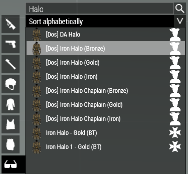
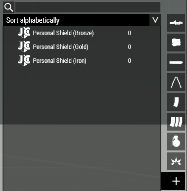

# Mod Page

## What is this mod?

This mod adds energy shields that work like Space Marine Iron Halos from the 40K Universe. Personal shields come in six tiers (Bronze, Iron, Gold, Plasteel, Ceramite, Auramite), Dreadnought and Terminator shields in the first three.

The shield type comes from the item: Personal, Dreadnought and Terminator shield items each have their own. Terminator shields use the dreadnought model for now. The HUD icon follows the unit: dreadnoughts (`WBK_DT_1`, `WBK_DT_Cont_1`) and terminators (`TDA_Base_Man`) get their own.

Most shields from other mods are just walls. These shields work like the shields in the lore:
- You **can** shoot from **inside to outside**;
- You **can't** be shot from **outside to inside** while the shield holds.

## How do they work?

You can get a shield in two ways:
1. Wear a compatible (Iron) Halo from the "facewear" category, as shown below
    
2. Carry one of the shield items from the misc. category in your inventory
    

If you have more than one, the highest tier is used.

Raise or lower the shield with ACE Self Interaction or the **Toggle Shield** keybind (default `Ctrl + Shift + K`).

### Health and time limit

Each shield has a pool of health that hits drain. Each tier can also have a time limit (on by default, 15 seconds, adjustable from 5 to 60). The shield goes down when either one runs out.

Hits drain health as follows:
- **Bullets** do damage equal to their penetration in mm of RHA steel, `typicalSpeed * (typicalSpeed / 1000) * caliber * 15 / 1000 * (1 - explosive)`. A 5.56 mm round does ~11, a 7.62 mm ~16, a .50 BMG ~30.
- **Explosions** do `explosive * hit` on a direct hit, or `explosive * indirectHit` for splash, weaker the further away the explosion is. Kinetic and explosive damage each have a multiplier setting (default 1).
- **Rapid fire reduction:** repeated hits from the same ammo type within a short window (default 1 s) deal less, `damage / (1 + repeats * factor)`. A rifle emptying a magazine or a minigun loses most of its damage per round, a single tank shell still hits at full strength. It can be turned off, and the window and factor are settings.

The shield changes colour as it takes damage, from **blue** to **yellow** (below 60%) to **red** (below 25%, about to break). At 0 it breaks and disappears.

Every tier uses the Gold model, so nothing passes through the shield while it holds. Tiers only differ in health.

When hit, personal shields sweep a band of lightning across the dome in their current colour. Their model has a `Hit` overlay layer whose UVs slide, the same technique as the TIOW Warhound's void shield. Dreadnought and terminator shields don't have that layer yet, so they flash by swapping textures instead (a client setting under Core > Effects turns that flash off). Both sets of textures are generated by `python3 tools/generate_hit_textures.py [seed]` as PNGs, convert them with the `.png -> .paa` task.

### Cooldown

- **Broken** or **expired** shields need the full cooldown.
- Shields **turned off early** recharge faster in proportion to what was left: at 50% left the cooldown is 50% shorter, at 95% it is 95% shorter. For time limited shields, "what was left" is the lower of health and time.
- A shield turned off with everything left comes back after the **Minimum Cooldown** (10 seconds by default).

Shields always come back at full health.

### HUD

A diamond in the bottom left shows the shield's state:
- **Gold, full**: ready;
- **Dimmed frame, coloured fill**: active, the fill shows the remaining health and the text the health and seconds left;
- **Grey**: recharging, the fill shows the recharge progress and the text the seconds left.

The icon changes for terminators and dreadnoughts. You can move, scale or hide the HUD in the addon settings.

### Zeus

With [Zeus Enhanced](https://steamcommunity.com/sharedfiles/filedetails/?id=1779063631) loaded, the Zeus context menu (`V`) has an **Energy Shields** category:
- **Toggle Shield**: for selected units that carry a shield device. It follows the same rules as the player toggle, so a shield on cooldown won't come up.
- **Add Shield**: lists the shield items that fit the unit under the cursor (personal ones for regular units, terminator ones for terminators, dreadnought ones for dreadnoughts). Only shown when the unit carries no shield item.
- **Remove Shield**: lowers the shield and removes the shield items from the unit's inventory (facewear halos are left alone). Only shown when the unit carries one.

## Settings

CBA settings under **Addon Options**, can be forced by the server or mission:

- **JCaleb's Energy Shields - Core**
  - Damage: minimum cooldown (10 s), kinetic / explosive damage multipliers (1 / 1, up to 20), ignore friendly fire (on), rapid fire reduction (on, 1 s window, factor 1)
  - HUD: visibility, text, position and scale (per player)
- **JCaleb's Energy Shields - Dreadnought** / **Personal** / **Terminator**: for every tier, health, cooldown, time limit on/off and maximum duration

Health grows ~35% per tier, dreadnought shields get 4x and terminator shields 2x. Every tier defaults to a 67 s cooldown and a 15 s time limit.

| Tier | Personal health | Dreadnought health | Terminator health |
| --- | --- | --- | --- |
| 1: Bronze | 600 | 2400 | 1200 |
| 2: Iron | 810 | 3240 | 1620 |
| 3: Gold | 1093 | 4372 | 2186 |
| 4: Plasteel | 1475 | - | - |
| 5: Ceramite | 1992 | - | - |
| 6: Auramite | 2690 | - | - |

- **JCaleb's Energy Shields - AI**: whether AI raise their shields on their own (on), and the chance they do when hit (75%), when an enemy fires a grenade, launcher or shell nearby (50%) and when suppressed (25%). Each kind of danger rolls at most once per re-roll interval (3 s) per unit. Zeus and scripts can always raise AI shields. Opt a single unit out with `_unit setVariable ["jces_main_aiEnabled", false]` where it is local.
- **JCaleb's Energy Shields - Sounds** (per player, only you hear them): enable/disable, and the sound file (`.wss`, `.ogg` or `.wav` path, empty for none) played when the shield turns on, turns off, is depleted and is ready. Defaults are the mod's own sounds, e.g. `\CalebsShields\jces_shields\Sounds\shield_on.ogg`.

## Scripting

All functions run in the unscheduled environment and forward themselves to the machine the unit is local to.

```sqf
[_unit] call jces_main_fnc_activate;       // Raise the shield
[_unit] call jces_main_fnc_deactivate;     // Lower it (shortened cooldown)
[_unit, true] call jces_main_fnc_deactivate; // Break it (full cooldown)
[_unit] call jces_main_fnc_isActive;
["B_556x45_Ball"] call jces_main_fnc_getAmmoDamage; // Damage a hit from this ammo does
```

These CBA local events fire on the unit's machine:
- `jces_main_shieldActivated` `[unit, shield]`
- `jces_main_shieldDamaged` `[unit, shield, damage, healthLeft]`
- `jces_main_shieldDeactivated` `[unit, broken, cooldown]`

### Adding your own shield items or halos

Add these properties to a `CfgWeapons` item or a `CfgGlasses` facewear class:
```cpp
jces_shieldTier = 2;            // 1 Bronze, 2 Iron, 3 Gold, 4 Plasteel, 5 Ceramite, 6 Auramite 
jces_shieldType = "Personal";   // or "Dreadnought" / "Terminator" (tiers 1-3)
```

### Retexturing

The shield's colour is set through `hiddenSelections[] = {"Outside", "Inside"};`.

## Building

The mod is built with [HEMTT](https://hemtt.dev): `hemtt check` to lint, `hemtt build` for a development build, `hemtt release` for a release.
Textures are kept as PNGs under `addons/`. The `.png -> .paa` VS Code task converts every changed PNG (ImageToPAA through Wine, cached in `png_to_paa_cache.json`), and the Build, Release and Deploy tasks run it first.

## Compatibility

- [x] [Dosiel Funtime 40k Models](https://steamcommunity.com/sharedfiles/filedetails/?id=2107836294)
- [x] [Black Templars Armoury](https://steamcommunity.com/sharedfiles/filedetails/?id=2452029370)

If your mod adds new iron halo models and you want compatibility, reach out or add the config properties above.

## Credits

* Bal & The Ultramarines - Initial idea after initial prototype shield was developed, patience and playtesting;
* Drell - As always, beautiful mod screenshots.
